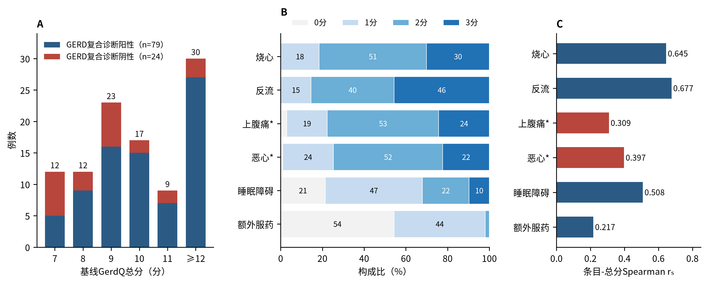
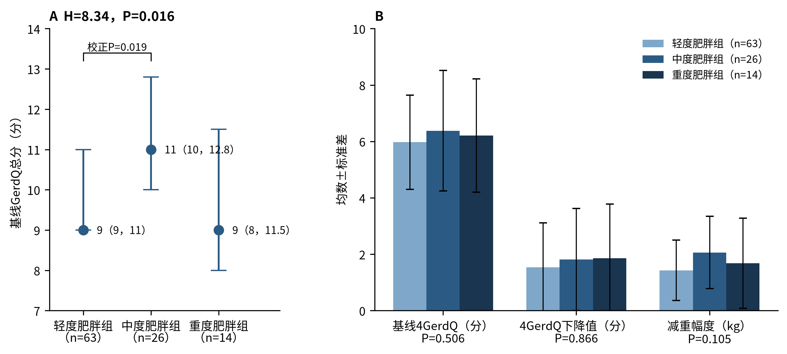
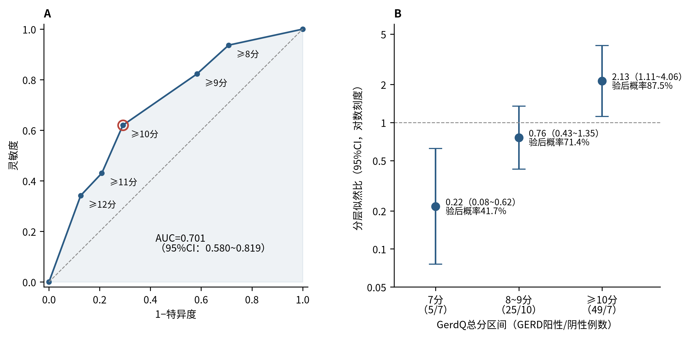
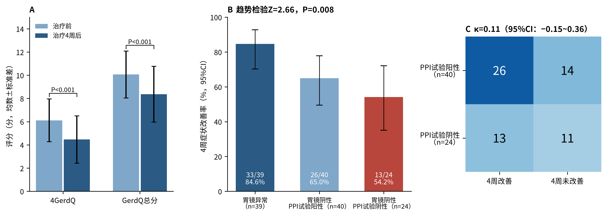
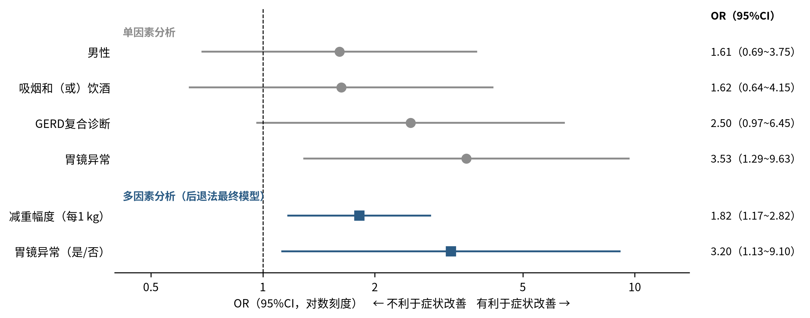

# GerdQ高原肥胖GERD研究：统计图表汇总（供核对）

本文件由`stats/code/run_all.py`自动生成。表中数据均来自`stats/inputs/summary_data.json`（原稿报告值）及由其精确推算的结果；121项一致性核查见`stats/output/checks/一致性核查.csv`。

## 一、正文表格

**表1　不同肥胖程度组患者基线资料比较**

| 项目 | 轻度肥胖组（*n*=63） | 中度肥胖组（*n*=26） | 重度肥胖组（*n*=14） | 合计（*n*=103） | 统计量 | *P*值 |
|---|---|---|---|---|---|---|
| 年龄（岁，$\bar{x}$±*s*） | 52.75±11.09 | 53.27±12.36 | 41.79±11.88 | 51.39±12.04 | *H*=9.13 | 0.010 |
| 身高（m，$\bar{x}$±*s*） | 1.66±0.06 | 1.67±0.09 | 1.63±0.08 | 1.66±0.08 | *H*=2.10 | 0.350 |
| 体重（kg，$\bar{x}$±*s*） | 79.61±6.32 | 88.44±10.53 | 102.46±13.05 | 84.94±11.66 | *H*=34.51 | <0.001 |
| BMI（kg/m²，$\bar{x}$±*s*） | 28.74±0.54 | 31.59±1.44 | 38.46±3.36 | 30.78±3.60 | *H*=76.80 | <0.001 |
| 男性［例（%）］ | 38（60.3） | 13（50.0） | 4（28.6） | 55（53.4） | χ²=4.80 | 0.091 |
| 吸烟和（或）饮酒［例（%）］ | 25（39.7） | 7（26.9） | 2（14.3） | 34（33.0） | χ²=3.92 | 0.141 |
| 胃镜异常［例（%）］ | 25（39.7） | 10（38.5） | 4（28.6） | 39（37.9） | χ²=0.61 | 0.738 |
| PPI试验阳性［例（%）］ | 34（54.0） | 13（50.0） | 10（71.4） | 57（55.3） | χ²=1.81 | 0.404 |
| GERD复合诊断［例（%）］ | 48（76.2） | 20（76.9） | 11（78.6） | 79（76.7） | χ²=0.04 | 0.982 |
| 基线GerdQ总分［分，*M*（*Q*₁，*Q*₃）］ | 9（9，11） | 11（10，12.8） | 9（8，11.5） | 10（9，12） | *H*=8.34 | 0.016 |
| 基线4GerdQ（分，$\bar{x}$±*s*） | 5.97±1.67 | 6.38±2.14 | 6.21±2.01 | 6.11±1.84 | *H*=1.36 | 0.506 |
| 减重幅度（kg，$\bar{x}$±*s*） | 1.43±1.07 | 2.06±1.28 | 1.68±1.60 | 1.62±1.22 | *H*=4.51 | 0.105 |

注：BMI为体质指数；PPI为质子泵抑制剂；GERD为胃食管反流病；4GerdQ为GerdQ第1、2、5、6条得分之和；减重幅度为减重管理后体重较基线的下降值。计数资料组间比较采用χ²检验；计量资料采用Kruskal-Wallis *H*检验

**表2　103例患者基线GerdQ各条目得分分布及条目-总分相关性**

| 条目 | 0分［例（%）］ | 1分［例（%）］ | 2分［例（%）］ | 3分［例（%）］ | 得分（分，$\bar{x}$±*s*） | 条目-总分*r*ₛ |
|---|---|---|---|---|---|---|
| 烧心 | 0（0.0） | 19（18.4） | 53（51.5） | 31（30.1） | 2.12±0.69 | 0.645 |
| 反流 | 0（0.0） | 15（14.6） | 41（39.8） | 47（45.6） | 2.31±0.71 | 0.677 |
| 上腹痛\* | 3（2.9） | 20（19.4） | 55（53.4） | 25（24.3） | 1.99±0.75 | 0.309 |
| 恶心\* | 1（1.0） | 25（24.3） | 54（52.4） | 23（22.3） | 1.96±0.71 | 0.397 |
| 睡眠障碍 | 22（21.4） | 48（46.6） | 23（22.3） | 10（9.7） | 1.20±0.89 | 0.508 |
| 额外服药 | 56（54.4） | 45（43.7） | 2（1.9） | 0（0.0） | 0.48±0.54 | 0.217 |

注：\*阴性预测条目，反向计分（得分越高表示症状天数越少）；条目-总分相关采用Spearman秩相关

**表3　GerdQ总分不同截断值识别GERD复合诊断的效能**

| 截断值（分） | 灵敏度［%（95%CI）］ | 特异度［%（95%CI）］ | 阳性预测值（%） | 阴性预测值（%） | 约登指数 |
|---|---|---|---|---|---|
| ≥8 | 93.7（86.0~97.3） | 29.2（14.9~49.2） | 81.3 | 58.3 | 0.228 |
| ≥9 | 82.3（72.4~89.1） | 41.7（24.5~61.2） | 82.3 | 41.7 | 0.239 |
| ≥10 | 62.0（51.0~71.9） | 70.8（50.8~85.1） | 87.5 | 36.2 | 0.329 |
| ≥11 | 43.0（32.7~54.0） | 79.2（59.5~90.8） | 87.2 | 29.7 | 0.222 |
| ≥12 | 34.2（24.7~45.2） | 87.5（69.0~95.7） | 90.0 | 28.8 | 0.217 |

注：GERD复合诊断阳性79例、阴性24例；灵敏度和特异度的95%CI采用Wilson法；阳性/阴性似然比分别为≥8分1.32/0.22，≥9分1.41/0.43，≥10分2.13/0.54，≥11分2.07/0.72，≥12分2.73/0.75；因入组要求门诊GerdQ≥7分，本表不能反映≤7分时的诊断效能

**表4　GerdQ总分分层似然比及验后概率**

| 总分区间 | 阳性/阴性（例） | 分层似然比（95%CI） | 本组验后概率（%） | 验后概率^a^（%） | 验后概率^b^（%） |
|---|---|---|---|---|---|
| 7分 | 5/7 | 0.22（0.08~0.62） | 41.7 | 8.5 | 17.8 |
| 8~9分 | 25/10 | 0.76（0.43~1.35） | 71.4 | 24.6 | 43.2 |
| ≥10分 | 49/7 | 2.13（1.11~4.06） | 87.5 | 47.7 | 68.0 |

注：^a^验前概率为30%时；^b^验前概率为50%时；各区间例数为GERD复合诊断阳性/阴性例数，由表3截断值结果反推；本组验前概率（GERD复合诊断比例）为76.7%；分层似然比的95%CI采用对数法；验后概率=验后比值/（1+验后比值），验后比值=验前比值×分层似然比

**表5　103例患者治疗前后GerdQ评分及体重变化**

| 指标 | 结果 | 统计量或95%CI |
|---|---|---|
| 治疗前4GerdQ（分，$\bar{x}$±*s*） | 6.11±1.84 | — |
| 治疗后4GerdQ（分，$\bar{x}$±*s*） | 4.46±2.04 | — |
| 4GerdQ下降值（分，$\bar{x}$±*s*） | 1.65±1.67 | 95%CI：1.31~1.99；Wilcoxon *W*=0，*P*<0.001；配对*t*=10.01，*P*<0.001 |
| 症状改善（下降≥1分）［例（%）］ | 72（69.9） | 95%CI：60.5%~77.9% |
| 改善者4GerdQ下降值（分，$\bar{x}$±*s*） | 2.36±1.52 | — |
| 治疗后4GerdQ≤1分［例（%）］ | 8（7.8） | 95%CI：4.0%~14.6% |
| GerdQ总分（治疗前→治疗后，分，$\bar{x}$±*s*） | 10.06±2.02→8.36±2.40 | Wilcoxon *P*<0.001 |
| 上腹痛+恶心条目合计（治疗前→治疗后，分） | 3.95→3.90 | — |
| 减重幅度（kg，$\bar{x}$±*s*） | 1.62±1.22 | 范围：−1~5 |

注：4GerdQ为GerdQ第1、2、5、6条得分之和；下降值=治疗前−治疗后；率的95%CI采用Wilson法；改善者下降值由全体下降值的均数、标准差及未改善者下降值均为0推算；上腹痛+恶心条目合计=GerdQ总分−4GerdQ

**表6　症状改善组与未改善组临床资料比较**

| 项目 | 改善组（*n*=72） | 未改善组（*n*=31） | 统计量 | *P*值 |
|---|---|---|---|---|
| 年龄（岁，$\bar{x}$±*s*） | 51.53±11.81 | 51.06±12.74 | *U*=1 152 | 0.798 |
| BMI（kg/m²，$\bar{x}$±*s*） | 30.53±3.07 | 31.38±4.60 | *U*=1 042.5 | 0.600 |
| 体重（kg，$\bar{x}$±*s*） | 83.79±10.99 | 87.63±12.90 | *U*=968 | 0.288 |
| 基线4GerdQ（分，$\bar{x}$±*s*） | 6.28±1.75 | 5.71±1.99 | *U*=1 297 | 0.188 |
| 基线GerdQ总分（分，$\bar{x}$±*s*） | 10.19±2.09 | 9.74±1.84 | *U*=1 251 | 0.328 |
| 减重幅度（kg，$\bar{x}$±*s*） | 1.86±1.30 | 1.08±0.80 | *U*=1 513 | 0.003 |
| 减重百分比（%，$\bar{x}$±*s*） | 2.26±1.55 | 1.23±0.92 | *U*=1 583 | 0.001 |
| 男性［例（%）］ | 41（56.9） | 14（45.2） | χ²=0.78 | 0.377 |
| 吸烟和（或）饮酒［例（%）］ | 26（36.1） | 8（25.8） | χ²=0.63 | 0.429 |
| 胃镜异常［例（%）］ | 33（45.8） | 6（19.4） | χ²=5.38 | 0.020 |
| GERD复合诊断［例（%）］ | 59（81.9） | 20（64.5） | χ²=2.77 | 0.096 |

注：症状改善定义为治疗后4GerdQ较基线下降≥1分；计量资料采用Mann-Whitney *U*检验；计数资料采用χ²检验（2×2表连续性校正）

**表7　症状改善相关因素的多因素Logistic回归分析**

| 变量 | *β* | *SE* | Wald χ² | *OR*（95%CI） | *P*值 |
|---|---|---|---|---|---|
| 减重幅度（每1 kg） | 0.597 | 0.224 | 7.10 | 1.82（1.17~2.82） | 0.008 |
| 胃镜异常（是/否） | 1.164 | 0.533 | 4.77 | 3.20（1.13~9.10） | 0.029 |
| 常数项 | −0.379 | 0.392 | 0.93 | — | 0.334 |

注：候选变量为年龄、性别、BMI、吸烟和（或）饮酒、高风险职业、基线4GerdQ、胃镜结果和减重幅度，后退法（*P*>0.10剔除）；Wald χ²、*OR*及95%CI由*β*和*SE*重新计算；未改善组31例，事件数与候选变量数之比约为3.9，结果存在过拟合风险

## 二、正文图件

{width=16cm}

**图1　基线GerdQ总分分布（A）、各条目得分构成（B）及条目-总分相关性（C）**

{width=16cm}

**图2　不同肥胖程度组基线GerdQ总分（A）及基线4GerdQ、4GerdQ下降值和减重幅度（B）比较**

{width=16cm}

**图3　GerdQ总分识别GERD复合诊断的ROC曲线（A）及分层似然比（B）**

{width=16cm}

**图4　治疗前后GerdQ评分变化（A）、不同诊断路径患者的4周症状改善率（B）及PPI试验与4周症状改善的一致性（C）**

{width=16cm}

**图5　症状改善相关因素的单因素与多因素分析**

## 三、附表

**附表S1　重建的GerdQ总分与GERD复合诊断交叉分布**

| GerdQ总分（分） | GERD复合诊断阳性（例） | GERD复合诊断阴性（例） | 合计（例） | GERD比例（%） | 逐分似然比（95%CI） |
|---|---|---|---|---|---|
| 7 | 5 | 7 | 12 | 41.7 | 0.22（0.08~0.62） |
| 8 | 9 | 3 | 12 | 75.0 | 0.91（0.27~3.10） |
| 9 | 16 | 7 | 23 | 69.6 | 0.69（0.32~1.49） |
| 10 | 15 | 2 | 17 | 88.2 | 2.28（0.56~9.27） |
| 11 | 7 | 2 | 9 | 77.8 | 1.06（0.24~4.78） |
| ≥12 | 27 | 3 | 30 | 90.0 | 2.73（0.91~8.23） |
| 合计 | 79 | 24 | 103 | 76.7 | — |

注：各分值例数由原稿截断值表的灵敏度、特异度唯一反推，并与原稿PPV、NPV、约登指数、*U*值逐一核对一致；GERD比例随分值升高的趋势检验：Cochran-Armitage *Z*=3.07，*P*=0.002（≥12分按12分计）；按本表计算的AUC=0.700（DeLong法95%CI：0.579~0.821）

**附表S2　不同诊断路径患者的GerdQ评分与4周症状改善**

| 诊断路径 | 例数 | GerdQ≥10分［例（%）］ | GerdQ≥10分 95%CI | 4周症状改善［例（%）］ | 症状改善 95%CI |
|---|---|---|---|---|---|
| 胃镜异常 | 39 | 28（71.8） | 56.2%~83.5% | 33（84.6） | 70.3%~92.8% |
| 胃镜阴性、PPI试验阳性 | 40 | 21（52.5） | 37.5%~67.1% | 26（65.0） | 49.5%~77.9% |
| 胃镜阴性、PPI试验阴性 | 24 | 7（29.2） | 14.9%~49.2% | 13（54.2） | 35.1%~72.1% |
| 趋势检验 | — | *Z*=3.31 | *P*<0.001 | *Z*=2.66 | *P*=0.008 |

注：例数由原稿报告数据推算（胃镜异常39例；胃镜阴性且PPI试验阳性40例；GERD阴性24例；改善组中GERD阳性59例、胃镜异常33例；GerdQ≥10分者在两种结局下的灵敏度、特异度）；趋势检验为Cochran-Armitage检验（评分2、1、0）；率的95%CI采用Wilson法。胃镜阴性者（64例）中以GerdQ≥10分识别PPI试验阳性：灵敏度52.5%（37.5%~67.1%），特异度70.8%（50.8%~85.1%），*OR*=2.68，Fisher确切概率法*P*=0.077

**附表S3　症状改善的单因素与多因素OR及E值**

| 变量 | 分析 | *OR*（95%CI） | *P*值 | E值（点估计） | E值（95%CI下限） |
|---|---|---|---|---|---|
| 男性 | 单因素 | 1.61（0.69~3.75） | 0.377 | 1.85 | 1.00 |
| 吸烟和（或）饮酒 | 单因素 | 1.62（0.64~4.15） | 0.429 | 1.87 | 1.00 |
| 胃镜异常 | 单因素 | 3.53（1.29~9.63） | 0.020 | 3.16 | 1.53 |
| GERD复合诊断 | 单因素 | 2.50（0.97~6.45） | 0.096 | 2.54 | 1.00 |
| 减重幅度（每1 kg） | 多因素 | 1.82（1.17~2.82） | 0.008 | 2.03 | 1.38 |
| 胃镜异常（是/否） | 多因素 | 3.20（1.13~9.10） | 0.029 | 2.98 | 1.32 |

注：单因素*OR*由原稿表6四格表计算（行：改善组、未改善组；列：有、无该特征，即*OR*=(a×d)/(b×c)），95%CI采用Woolf法，*P*值为连续性校正χ²检验；计量资料无原始数据，无法计算单因素*OR*，以Hedges *g*表示：减重幅度*g*=0.66，减重百分比*g*=0.73；E值按VanderWeele法计算（结局常见，先以√*OR*近似换算为*RR*），表示能完全解释该关联所需的未测混杂强度（*RR*尺度），95%CI下限≤1时E值记为1.00

**附表S4　胃镜阴性者PPI试验与4周症状改善的一致性**

| 胃镜阴性者（*n*=64） | 4周症状改善（例） | 4周未改善（例） | 合计（例） |
|---|---|---|---|
| PPI试验阳性 | 26 | 14 | 40 |
| PPI试验阴性 | 13 | 11 | 24 |
| 合计 | 39 | 25 | 64 |

注：一致率57.8%；Cohen κ=0.11（95%CI：−0.15~0.36）

**附表S5　原列线图模型评价指标重估**

| 指标 | 原稿报告 | 重新评估 | 说明 |
|---|---|---|---|
| 事件数与候选变量数之比（EPV） | 未报告 | 3.9 | 未改善组31例/8个候选变量；一般要求≥10 |
| 表观AUC（95%CI） | 0.728 | 0.728（0.629~0.827） | Hanley-McNeil法 |
| 校正AUC（95%CI） | 0.714（0.705~0.730） | 0.714（0.613~0.815） | 原稿区间为Bootstrap乐观度的波动范围，不是AUC的置信区间 |
| 校准斜率 | 1.00 | 不适用 | 在建模数据上计算的Logistic回归表观校准斜率恒为1 |
| 预测变量时间顺序 | — | 不满足 | 减重幅度在治疗结束时才能获得，不能用于治疗前预测 |

注：基于原稿报告值计算；修改稿据此删除列线图

**附表S6　后续研究样本量估算**

| 研究目标 | 假设 | 所需例数 |
|---|---|---|
| 估计特异度 | 预期30%，95%CI半宽±10% | 非GERD患者81例；按患病率76.7%，共约348例 |
| 估计灵敏度 | 预期90%，95%CI半宽±5% | GERD患者139例；共约182例 |
| 疗效模型外部验证 | 结局事件与非事件各≥100例 | 按未改善率30.1%，约333例 |

注：按正态近似公式 n=1.96²×p×(1−p)/d² 计算
